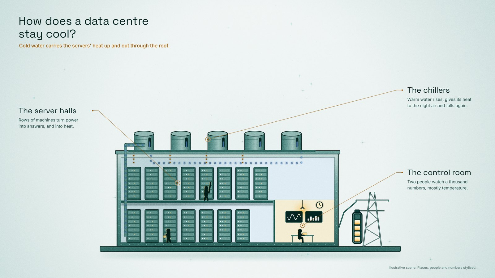

# From a question to a finished slide in two minutes

This walk-through starts with a question you want to explain and ends with an illustrated slide and an editable deck in one Lantern colour. On a laptop the scene renders in about 12 seconds and the ten-slide template in about 40.

<p align="center"></p>

## 1. Pick a colour (20 seconds)

Open the **[Lantern playground](https://amircode2050.github.io/lantern-design-system/)** and click through the twelve colours. The whole page follows your choice: the scenes, the shade ramp, the buttons and cards. Switch between dark and light and try a type set or two.

For this example: **Teal, light**.

## 2. Install the skill (30 seconds, once)

In Claude Code:

```
/plugin marketplace add Amircode2050/lantern-design-system
/plugin install lantern@lantern-design-system
```

On claude.ai, upload `lantern.zip` from the [latest release](https://github.com/Amircode2050/lantern-design-system/releases/latest) under Settings, Capabilities, Skills. Other agents are listed in the [README](../README.md#1-install-the-skills).

The machine that renders needs Python 3.11+ and:

```bash
pip install pillow numpy playwright python-pptx
python -m playwright install chromium
```

## 3. Ask your question (15 seconds)

Write the request the way you would brief a designer: the question, the colour, the variant.

> A slide that explains how a data centre stays cool. Lantern teal, light.

Naming the colour and variant skips the picker. Leave them out and the skill shows you the colours first.

## 4. Get the slide (about 12 seconds)

The skill draws a cut-away and sets the words around it:

- **The question** as the title: *How does a data centre stay cool?*
- **One line of answer** under it: *Cold water carries the servers' heat up and out through the roof.*
- **Three labelled parts**, each with a leader line into the drawing: the server halls, the chillers, the control room.

Data centres are one of 24 ready scenes, so this one comes straight from the library. For a topic outside it, the skill draws a new scene in the same style, which takes a few passes longer.

Without an agent, the same slide is one command inside the skill folder:

```bash
python scripts/scenes.py data_centre teal light
```

Add `clean` for the picture without words, or `fa` or `es` for Persian or Spanish.

## 5. Put it in a deck (about 40 seconds)

> Give me a PowerPoint template in Lantern teal, light.

Or:

```bash
python scripts/deck.py teal light --out teal.pptx
```

You get ten slides: title, agenda, section break, three illustrated explainers, text, two columns, a chart and a closing slide. Every title, label and number is editable, and the template's own colours and fonts are set, so anything you add matches. It opens in PowerPoint, Keynote and Google Slides.

If you only need the template, skip the install: every colour's deck is a download on the playground and in each release.

## Where to go next

- Ask for the same scene as a social post: "Turn the data centre scene into an Instagram story, Lantern teal."
- Make a colour from your brand: "Here is our logo. Make a Lantern colour from it."
- Browse every scene and option in the [README](../README.md).
